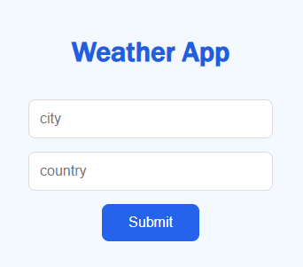

# Weather App

A simple weather application that allows users to check the current temperature in cities around the world.

Built with HTML, CSS, and JavaScript, the application integrates two external APIs to convert a city and country into geographic coordinates and retrieve location-specific weather data.

## Live Demo

**[View Weather App](https://anwaralshohatee.github.io/weather-app/)**

## Technologies


## Features

- Search for weather information by city and country
- Convert location names into latitude and longitude coordinates
- Retrieve current temperature data using the WeatherAPI service
- Display temperatures in Fahrenheit
- Update results dynamically using JavaScript
- Integrate multiple external APIs using the Fetch API

## Screenshot



## How It Works

1. Enter a city and country.
2. Click **Submit**.
3. The application sends the location to the Geocode.maps.co API.
4. The API returns geographic coordinates.
5. The application uses those coordinates to request weather data from WeatherAPI.
6. The current temperature is displayed in Fahrenheit.

## APIs Used

### Geocode.maps.co

Converts city and country information into latitude and longitude coordinates.

https://geocode.maps.co/

### WeatherAPI

Provides current weather information, including temperature.

https://www.weatherapi.com/

## Getting Started

### 1. Clone the Repository

```bash
git clone https://github.com/AnwarAlshohatee/weather-app.git
cd weather-app
```

### 2. Run the Application

Open `index.html` in your browser.

No additional packages or build tools are required.

An internet connection and valid API credentials are required for the weather lookup to work.

## Future Improvements

- Add input validation and error messages
- Display additional weather details such as humidity and wind speed
- Add weather condition icons
- Support Celsius and Fahrenheit temperature conversion
- Improve mobile responsiveness
- Secure API credentials using a backend or serverless function

## Author

**Anwar Alshohatee**

[Portfolio](https://anwaralshohatee.netlify.app) | [LinkedIn](https://www.linkedin.com/in/anwaralshohatee/)
